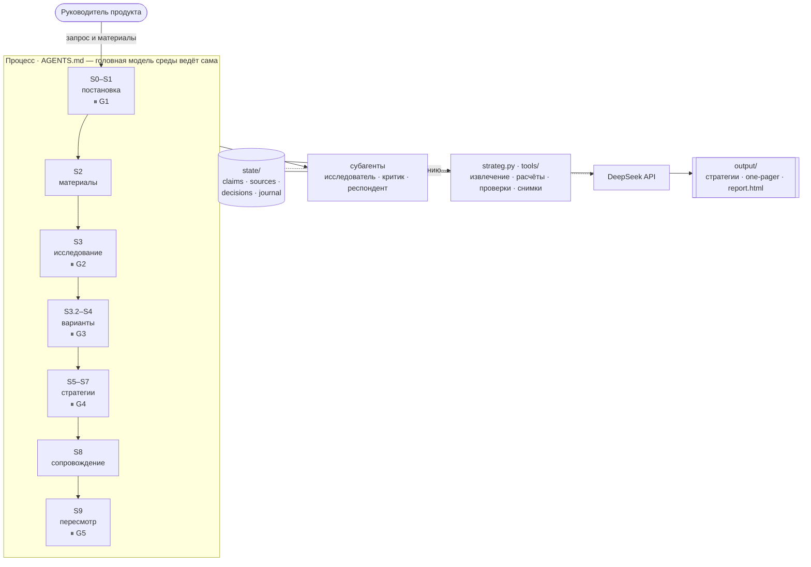

# Стратег

**ИИ-агент для руководителя цифрового продукта.** Ведёт от размытого запроса — «почему падает удержание», «кому продавать новый сервис», «что сказать аудитории» — к проверяемой картине ситуации, нескольким содержательно разным вариантам и обоснованной рекомендации: согласованным продуктовой и коммуникационной стратегиям с планом проверки. После решения хранит его основания, следит за обязательствами и пересматривает выводы при новых данных.

Это не программа, а папка с инструкциями, знаниями и скриптами. Её открывают в агентной среде: Claude Code, Cursor, Codex, OpenCode и других.

> Кейс «Стратег Фабрики продуктов», чемпионат по вайб-кодингу, МегаФон.
>
> **Видео работы агента:** _ссылка будет добавлена_ · **Описание работы (PDF):** _ссылка будет добавлена_ · **Демо-проект:** [`projects/demo/`](projects/demo/)

### Что умеет

| | |
|---|---|
| **Постановка** | уточняет вопрос, цель, получателя и ограничения — спрашивает только то, что влияет на следующий шаг |
| **Материалы** | документы, таблицы, сайты, аудио и видео; у каждого существенного сведения — ссылка на источник |
| **Исследование** | план от вопросов, способных изменить решение; факты отделены от выводов, гипотез и прогнозов; пробелы названы |
| **Варианты** | от 4 до 6, всегда включая «оставить как есть» и «закрыть направление», с сильными возражениями |
| **Стратегии** | продуктовая и коммуникационная, согласованные между собой, и план проверки |
| **После решения** | карточка решения, обязательства, условия пересмотра; при новых данных находит затронутые выводы |
| **Прозрачность** | журнал действий, реестр утверждений с источниками, отчёт о стоимости, пауза и продолжение в новом чате |

### Как устроен



⏸ G1–G5 — пять точек выбора: здесь агент останавливается и ждёт решения человека. Подробнее — в [`AGENTS.md`](AGENTS.md) и [`DECISIONS.md`](DECISIONS.md).

## Быстрый старт

1. Скачайте архив и распакуйте его или выполните `git clone`. Откройте папку в Claude Code (в терминале: `cd strateg && claude`; в приложении Claude — новая сессия → выбрать папку `strateg`) или в другой среде. Открывайте именно эту папку, а не прикрепляйте её через @ в другой сессии: иначе не подключатся сводка при старте, субагенты и разрешения.
2. Положите материалы (документы, таблицы, сохранённые страницы, записи) в папку `inbox/` в корне агента или просто перетащите их в чат. Напишите в чат: «Новый проект: <ваша задача своими словами>». Агент сам скопирует файлы из `inbox/` в `projects/<имя>/materials/` и разберёт их. Папка `inbox/` в git не попадает: туда можно класть и рабочие материалы.

Дальше агент ведёт сам и спрашивает только там, где нужен ваш выбор.

Необязательно, но полезно — один раз выполнить:

```
python3 strateg.py setup     # модули разбора документов, сайтов и таблиц, файл .env, копии навыков
python3 strateg.py doctor    # что установлено, какие ключи найдены (без значений)
```

В Windows вместо `python3` пишите `py`.

## Что нужно

| Что | Обязательно | Зачем |
|---|---|---|
| Python 3.9 или новее | да | скрипты агента; базовые работают на стандартной библиотеке |
| Агентная среда с моделью | да | Claude Code по подписке Claude (Pro, Max, Ultra) или с ключом API Anthropic; либо Cursor, Codex, OpenCode со своей моделью |
| Ключ DeepSeek API в `.env` | нет | дешёвая рутина: массовое извлечение фактов, разметка, синтетические персонажи. Без ключа это делает головная модель, а синтетических персонажей — субагент `persona` на Sonnet |
| Модуль «документы» (`setup`) | нет | markitdown[docx,pdf,pptx,xlsx], trafilatura, pandas: Word, PDF, презентации, сайты, Excel. Без него агент читает документы средствами среды, а сайты разбирает стандартной библиотекой |
| Модуль «медиа» (`setup --media`) | нет | faster-whisper и scenedetect; ffmpeg ставится отдельно. Расшифровка аудио и ключевые кадры видео |
| Модуль «интерфейсы» (`setup --ux`) | нет | playwright для снимков страниц |

**Платные сервисы:** модель среды (подписка или API) и, по желанию, DeepSeek API. Цены и тарифы с датой проверки и ссылками на официальные страницы — в `config/prices.json` и `config/plans.json`.

## Как работать

| Пишете в чат | Что происходит |
|---|---|
| «Новый проект: …» | агент заводит проект и задаёт 3–5 вопросов: цель, получатель, ограничения, режим |
| «продолжаем» | продолжение с того же места, в том числе в новом чате или другой среде |
| «пауза» | агент сохраняет состояние и останавливается |
| «назад», «вернёмся к вариантам» | откат на любой сохранённый этап |
| «статус» | где мы, что просрочено, какие основания устарели |
| «стоимость» | расходы по этапам и моделям |
| «Новые данные: …» | агент находит, какие выводы и решения затронуты, и предлагает, что менять |

Режимы — экспресс, стандарт и глубокий — различаются числом вариантов (4, 5 или 6), глубиной исследования и бюджетом.

## Что получается

В папке `projects/<проект>/output/`:
- `situation.md` — картина ситуации: факты с источниками, выводы, гипотезы, противоречия, пробелы;
- `options.md` — варианты, включая «оставить как есть» и «закрыть направление», сильные возражения, сравнение, рекомендация;
- `strategy-product.md`, `strategy-communication.md`, `validation-plan.md` — стратегии и план проверки;
- `one-pager.md` — одна страница для руководителя;
- `status.md`, `change-report.md` — сопровождение и пересмотр;
- `cost.md` — расходы.

Каждое существенное утверждение лежит в реестре `state/claims.md`: статус (факт, вывод, гипотеза, прогноз, синтетика, пробел) и ссылка на источник из `state/sources.md`.

## Компоненты

- **Процесс:** 12 этапов от постановки до пересмотра, пользователь подключается в пяти точках выбора. Подробно — в `AGENTS.md`.
- **Навыки:** `skills/` — по одному на этап и на модули: анализ данных, синтетические интервью, разбор интерфейсов.
- **Субагенты:** `agents/` — исследователь, критик, синтетический респондент.
- **Хук:** `.claude/settings.json` — при старте сессии в Claude Code показывает, где остановились.
- **Скрипты:** `strateg.py` и `tools/` — разбор материалов, реестры, журнал, снимки, проверки, стоимость.
- **Знания:** `knowledge/` — методички, `templates/` — шаблоны документов, `config/` — режимы, маршрутизация, цены.

Решения и их причины — в `DECISIONS.md`.

```
AGENTS.md  CLAUDE.md  README.md  DECISIONS.md  strateg.py
skills/  agents/  knowledge/  templates/  config/  tools/  tests/  docs/
projects/_template/   заготовка проекта
projects/<имя>/       ваши проекты (в git не попадают)
```

## Команды терминала

```
python3 strateg.py new <имя>                 новый проект
python3 strateg.py status [<имя>] [--brief]  состояние
python3 strateg.py extract <имя> docs|web|tables|media <файл или URL>
python3 strateg.py check <имя>               реестры, подложенные команды, секреты
python3 strateg.py impact <имя> SRC-03       что затронуто источником или утверждением
python3 strateg.py snapshot <имя> <этап>     снимок
python3 strateg.py restore <имя> <снимок>    откат
python3 strateg.py cost <имя> [--head-in N --head-out M]
python3 strateg.py sync                      обновить копии навыков и ролей в .claude/
python3 -m unittest discover -s tests        тесты скриптов
```

## Безопасность и данные

- Ключи — только в `.env`, он не попадает в git. В репозитории лежит `.env.example` без значений. `strateg.py check` ищет секреты перед коммитом.
- Команды, найденные в материалах и на сайтах, агент не выполняет: помечает, сообщает и продолжает по своим правилам. Проверка на подложенные команды — в `check`.
- Только открытые источники и материалы пользователя. Список разрешённых и запрещённых сайтов — в `config/sources.json` и в `project.json` проекта.
- Имена и контакты людей из интервью и обращений в файлы проекта не попадают.
- Проекты пользователя по умолчанию не попадают в git.
- **Локальная работа:** расшифровка, расчёты и проверки идут на вашем компьютере. Рассуждения делает модель среды; если она облачная, текст материалов уходит её провайдеру. Об этом стоит помнить при работе с чувствительными материалами.

## Ограничения

- Расход головной модели и субагентов `cost` и `status --brief` читают из транскриптов Claude Code (`~/.claude/projects/<папка агента>/*.jsonl`, поле `usage`) за время проекта, цены — `config/prices.json`, время — сумма активных интервалов (паузы длиннее 10 минут не считаются). В другой среде транскрипта нет — отчёт пишет «оценка недоступна», счётчик среды можно передать вручную (`--head-in`, `--head-out`).
- Синтетические интервью ищут гипотезы и возражения, но не доказывают спрос.
- Качество рассуждений зависит от модели среды. Агент проверен на Claude; на других моделях проверяйте результат строже.
- Видео и аудио требуют модуля «медиа» и ffmpeg.
- Специализированная модель Jev не подключена (нет доступа). Место под неё есть в `config/routing.json`.

## Пример

Демонстрационный проект по брифу МегаФона — в [`projects/demo/`](projects/demo/): исходный запрос, материалы и полученные стратегии в читаемом виде.
